# ai-engineering-lab

Small Python projects, written from scratch, one folder each.

## Why a lab

These projects share one idea: build the thing small, test it, and report what actually happened. Keeping them in one repository makes them easier to browse and compare.

## License

MIT, see [LICENSE](LICENSE).
