<p align="center"></p>

# ai-engineering-lab

Small, tested Python projects on RAG and LLM tooling, each written from scratch and each reporting its results honestly.

## Projects

All numbers below are copied from each project's own README. Most evaluations are on small or synthetic data, and each README says so in detail.

### RAG / LLM

| Project | What it is | Key tech | Result stated in its README |
|---|---|---|---|
| [bm25-from-scratch](rag-llm/bm25-from-scratch) | BM25 / BM25+ in pure Python with an accent-folding tokenizer and inverted index | Python stdlib | 16 docs, 16 queries: hit@1 0.938, MRR 0.969 (same as scikit-learn TF-IDF; "not a benchmark") |

## Run any project

Each project is self-contained. Open its folder and follow its README; the pattern is:

```bash
cd rag-llm/bm25-from-scratch          # any project folder
python -m venv .venv && source .venv/bin/activate    # Windows: .venv\Scripts\activate
pip install -e ".[test]"              # or: pip install -r requirements.txt pytest
python -m pytest -q
```

## Why a lab

These projects share one idea: build the thing small, test it, and report what actually happened. Keeping them in one repository makes them easier to browse and compare.

## License

MIT, see [LICENSE](LICENSE).
